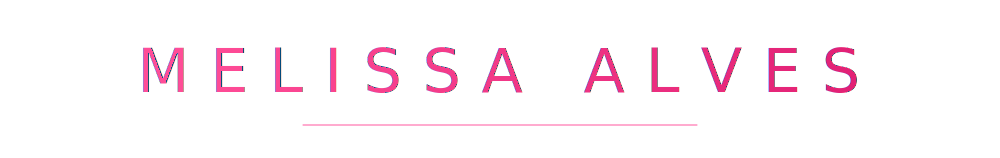
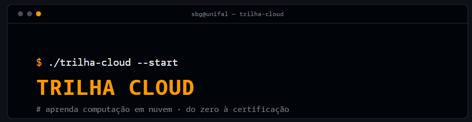

<!--
  Profile — Melissa Alves
  black + electric blue (#38bdf8)
-->

<!-- ═══════════  NAME  ═══════════ -->

  

 

---

<!-- ═══════════  ABOUT  ═══════════ -->

Computer Science undergraduate at **UNIFAL-MG** (Brazil, 4th semester), working at the intersection of **cloud architecture** and **applied AI research**. I founded my university's cloud computing league and built a free AWS curriculum from scratch. Currently preparing for **AWS Cloud Practitioner** and **Solutions Architect Associate**.

> 🎯 **Looking for:** Solutions Architect / Cloud Engineering internship

 

<!-- ═══════════  TECH STACK  ═══════════ -->
## 🛠 Tech Stack

**Languages**

**Cloud & DevOps**

**AI / ML**

 

<!-- ═══════════  PROJECTS  ═══════════ -->
## 🚀 Projects

---
### ☁️ [awscloudfoundations](https://github.com/melissaalves-stack/awscloudfoundations) `Education · Open Source · 19 ⭐`

Free AWS curriculum built from scratch for the **Academic Cloud League (LACEN) at UNIFAL-MG**. Zero-to-certification in Portuguese — no personal AWS account or credit card needed. Includes full Cloud Practitioner + AI Practitioner tracks, hands-on labs and community events.

| | |
|---|---|
| 🌐 **Site** | [awsbuildersunifal.vercel.app](https://awsbuildersunifal.vercel.app) |
| 🔧 **Content** | AWS Skill Builder · Builder Labs · SimuLearn |

  

 

---

### 🧫 [ic-biofilm-segmentation](https://github.com/melissaalves-stack/ic-biofilm-segmentation) `Research · IC · 2026–present`

Deep learning pipeline for biofilm microscopy image segmentation. Applies **U-Net**, **YOLOv8** and **Random Forest** to real lab data as part of an undergraduate research project (Iniciação Científica). Fully public and citable under open science principles.

| | |
|---|---|
| 📊 **Dataset** | [DOI: 10.5281/zenodo.21496449](https://doi.org/10.5281/zenodo.21496449) |
| 📄 **Article** | [DOI: 10.1016/j.dib.2026.113318](https://doi.org/10.1016/j.dib.2026.113318) |
| 🔧 **Stack** | Python · PyTorch · OpenCV · scikit-learn · YOLOv8 |

---

### 🌿 [Iara-Scientific-Agent](https://github.com/melissaalves-stack/Iara-Scientific-Agent) `AI Agent · Biodiversity`

**Iara** — offline scientific co-pilot for documenting traditional Amazonian plant knowledge in the field. Android app + 3 AI agents (Taxonomist → SiBBr/GBIF, Geospatial, RAG Scientific) validate each field record. Curator approves and exports in Darwin Core format, with community consent built in.

| | |
|---|---|
| 🌐 **Dashboard demo** | [melissaalves-stack.github.io/iara-scientific-agent](https://melissaalves-stack.github.io/iara-scientific-agent/) |
| 🔧 **Stack** | Python · Kotlin (Jetpack Compose) · React/TypeScript · SiBBr · GBIF |

---

### 🚀 [nasa-challenge](https://github.com/melissaalves-stack/nasa-challenge) `NASA Space Apps Challenge 2026`

**AstroKatu** — behavioral health monitoring that travels with the crew. Built for the NASA Space Apps Challenge 2026 (Team Pindorama). Runs fully on-board with no Earth link required: wearable vitals + daily check-in → local LLM → YAML rules → surgeon's review queue. Uses real Inspiration4 astronaut blood panels from NASA's Open Science Data Repository.

| | |
|---|---|
| 🌐 **Live prototype** | [nasa-challenge-five-rho.vercel.app](https://nasa-challenge-five-rho.vercel.app) |
| 🎥 **Demo** | [youtube.com/watch?v=P_3E3ZMBsng](https://youtu.be/P_3E3ZMBsng) |
| 🔧 **Stack** | Python · React · NASA OSDR API |

---

### 🪐 [corretor-cosmico](https://github.com/melissaalves-stack/corretor-cosmico) `AWS Serverless · Always-On Agent`

A fully autonomous AWS agent that picks a real exoplanet from NASA's catalog every morning and delivers a real-estate listing written by AI — in the voice of an intergalactic real-estate agent. Built for the AWS Builder Center Weekend Agent Challenge. All numbers (distance, travel time) computed in auditable Python; LLM writes only the prose.

| | |
|---|---|
| ⏰ **Trigger** | EventBridge Scheduler (daily, São Paulo timezone) |
| 🧠 **Memory** | DynamoDB (never repeats a planet) |
| 🔧 **Stack** | AWS Lambda · Amazon Bedrock (Nova Lite) · DynamoDB · SES · EventBridge |

<!-- ═══════════  LEADERSHIP  ═══════════ -->
## 🌐 Leadership

**Founder & President — Liga Acadêmica de Computação em Nuvem (LACEN), UNIFAL-MG**  
First cloud computing academic league at UNIFAL-MG. Free AWS curriculum, zero-to-cert path, open to all students.

**SBG Leader — Amazon**  
Leading team initiatives within the Amazon SBG program.

 

<!-- ═══════════  STATS  ═══════════ -->
## 📈 Stats

  

 

<!-- ═══════════  SNAKE  ═══════════ -->
## 🐍 Contribution Activity

  

 

<!-- ═══════════  CONTACT  ═══════════ -->
## 📬 Get in Touch

 

<!-- ═══════════  BANNER  ═══════════ -->

  

